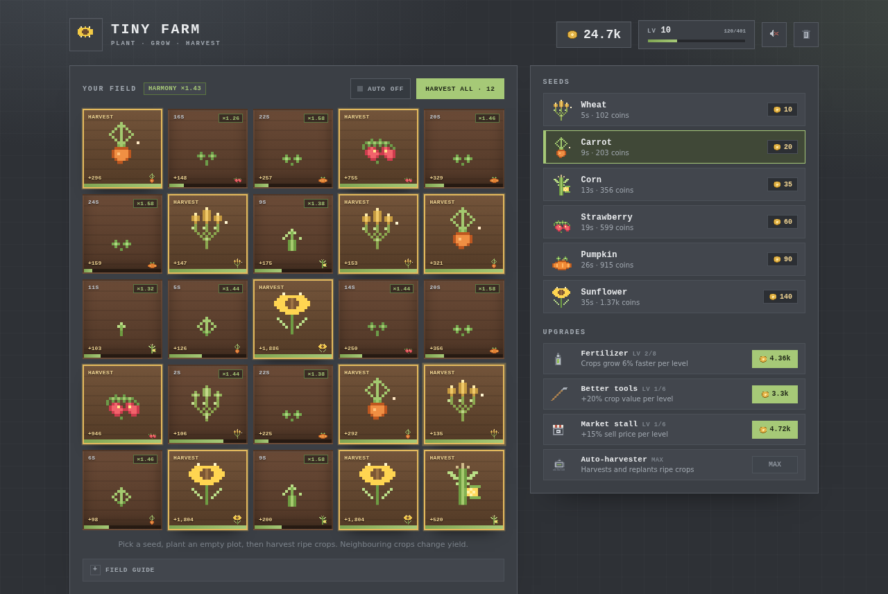
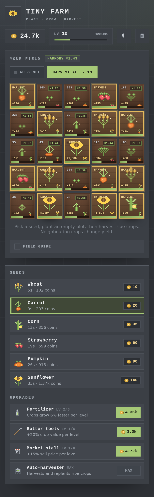
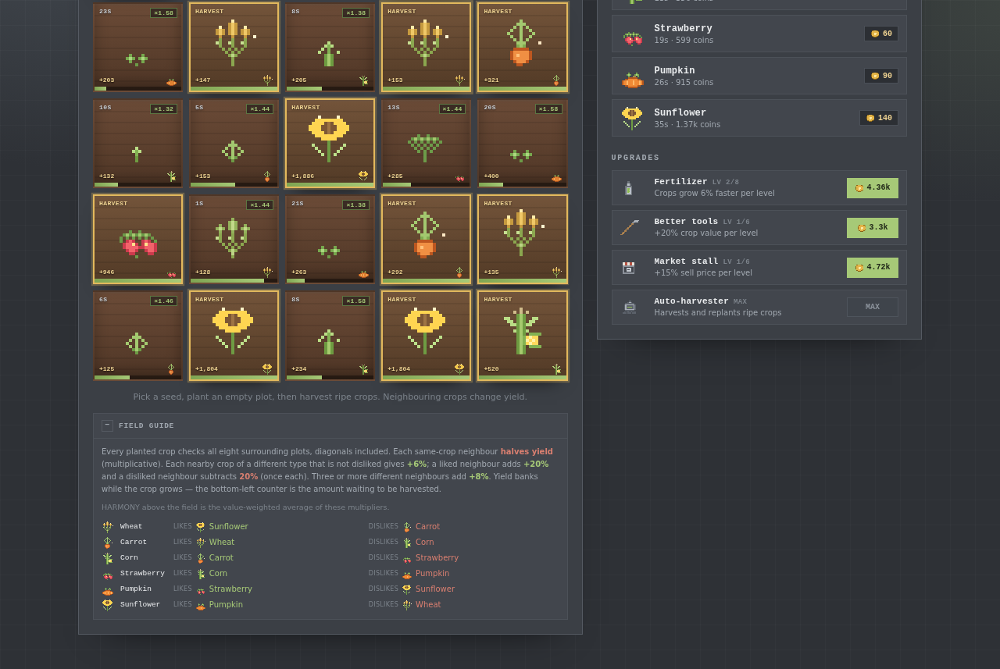

# Tiny Farm

A small incremental farming puzzle in plain HTML, CSS and JavaScript. Twenty-five plots, six crops, and a field where every neighbour matters. Yield banks continuously while a crop grows, so placement and timing both feed the harvest.



<details>
<summary>Mobile layout</summary>



</details>

## Play

Open `index.html` in your browser. That's it.

To serve it locally instead:

```bash
python3 -m http.server 8000
# then visit http://localhost:8000
```

Progress saves automatically to `localStorage`. The trash button in the top right wipes the save and starts over.

## The field

The field is a 5×5 grid. The four corners and the centre start unlocked; the other twenty plots are bought with coins.

Every planted crop looks at **all eight surrounding plots**, diagonals included. The current rate is shown as a `×1.23` badge while the crop grows.

- **Same crop neighbour:** each one **halves** the banked yield (multiplicative).
- **Any nearby crop of a different type that is not disliked:** +6% per neighbouring plot.
- **Liked neighbour present:** +20% extra, counted once.
- **Disliked neighbour present:** −20%, counted once.
- **Three or more different neighbours:** +8%.

The final multiplier is clamped between ×0.05 and ×1.75.

**Yield banks over time.** Each crop's sale value is spread over its growth time and multiplied by the current adjacency rate every second. The **bottom-left counter** is that integral, shown as a rounded integer (the float is kept internally). It stops when the crop ripens, and harvesting pays the counter. Planting or harvesting a neighbour mid-growth changes the rate for the remaining seconds only; seconds already banked keep the rate they had.

This is why the multiplier seems to affect more than the final harvest: it is the plant's yield *rate*, so it changes the live counter too. It is still paid once at harvest, and it does not change grow time or XP.

The **bottom-right mini icon** identifies the crop. The **HARMONY** chip above the field is the value-weighted average of the current multipliers. The in-game **Field guide** lists the rules and the whole crop ring.

## Crop ring

Each crop likes the next crop in this ring and dislikes the previous one:

`Carrot → Wheat → Sunflower → Pumpkin → Strawberry → Corn → Carrot`

| Crop | Likes | Dislikes |
| --- | --- | --- |
| Wheat | Sunflower | Carrot |
| Carrot | Wheat | Corn |
| Corn | Carrot | Strawberry |
| Strawberry | Corn | Pumpkin |
| Pumpkin | Strawberry | Sunflower |
| Sunflower | Pumpkin | Wheat |

The ring is arranged so each crop from carrot onward likes a partner that is already unlocked, and every non-disliked neighbour gives +6%, so once you have a second crop your current best crop can be pushed above ×1.

A two-crop checkerboard is usually a trap, because diagonals count. Expensive crops need elbow room; cheap crops are useful buffers. Finding a good packing is the puzzle.



## Crops

Base harvest value before upgrades and adjacency multipliers. The bottom-left counter is the actual banked amount, which may be above or below this depending on the average multiplier.

| Crop | Unlocks at | Seed cost | Grow time | Base value | XP |
| --- | ---: | ---: | ---: | ---: | ---: |
| Wheat | Lv 1 | 10 | 6 s | 58 | 1 |
| Carrot | Lv 2 | 20 | 10 s | 116 | 3 |
| Corn | Lv 4 | 35 | 15 s | 203 | 7 |
| Strawberry | Lv 6 | 60 | 22 s | 342 | 15 |
| Pumpkin | Lv 8 | 90 | 30 s | 522 | 30 |
| Sunflower | Lv 10 | 140 | 40 s | 780 | 60 |

Each tier is a modest step up rather than a replacement: base profit per second goes from 8 to 16 coins, so a well-placed wheat can beat a badly placed sunflower, and all six crops stay worth growing.

The longest crop takes 40 s, or about 21 s with maxed fertilizer. A crop's grow time is locked when it is planted, so fertilizer speeds up future plantings rather than retroactively shortening existing ones. Crops keep growing while the tab is closed.

## Plots

The four corners and the centre are free. The other twenty plots cost, in any order:

450, 750, 1.2k, 2k, 3k, 4.5k, 6.6k, 9.6k, 13.5k, 18.6k, 25.5k, 34.5k, 45k, 58.5k, 75k, 96k, 120k, 150k, 186k and 228k coins.

## Upgrades

| Upgrade | Levels | Effect per level | Base cost |
| --- | ---: | --- | ---: |
| Fertilizer | 8 | -6% grow time | 900 |
| Better tools | 6 | +20% crop value | 1,500 |
| Market stall | 6 | +15% sell price | 2,100 |
| Auto-harvester | 1 | Harvests and replants ripe crops (toggleable) | 60,000 |

Costs scale by ×2.2 per level (×2.25 for the market). Once the auto-harvester is owned, the **AUTO** switch appears in the field header. Turn it off to let crops sit ripe while you rearrange the field, and back on to let it harvest and replant the same layout.

## Finish line

The run is complete when you reach **level 10** and unlock **all 25 plots** — a toast marks it. Level 10 unlocks the sunflower; the economy is tuned so the whole farm can be finished in one sitting rather than as a long idle game.

Tips:

- Plant the five spaced free plots first; a starting wheat field there has no penalties.
- Read the bottom-left counter before harvesting and the rate badge while it grows. A cheap crop with a high multiplier can beat an expensive crop in a bad spot.
- If you add a good neighbour mid-growth, only the remaining growth benefits.
- The auto-harvester preserves your layout, so set the pattern up before switching it on.
- Seed costs are paid when planting; the banked counter is gross yield, not profit.

## Pixel art

Every crop, icon, and the favicon is a 16x16 PNG generated by `tools/generate_sprites.py` with [Pillow](https://python-pillow.org/). The sprites are defined as character grids with a palette per crop:

```bash
python3 tools/generate_sprites.py            # regenerate assets/crops and assets/icons
python3 tools/generate_sprites.py --preview  # also write a contact sheet to tools/preview.png
```

Each crop has four stages (sprout through ripe), and the ripe frame uses its own colours and silhouette. Pillow is the only dependency for regenerating art (`pip install pillow`).

## Files

| Path | Purpose |
| --- | --- |
| `index.html` | Page structure, HUD and field guide shell |
| `style.css` | Dark square-corner theme, 5×5 field, counters, badges and responsive layout |
| `game.js` | Game state, economy, adjacency rules, accrual and UI logic |
| `assets/crops/` | 24 generated crop frames (6 crops x 4 stages) |
| `assets/icons/` | Generated coin, lock, upgrade, sound, reset and logo icons |
| `tools/generate_sprites.py` | Sprite generator |
| `screenshots/` | Screenshots used in this README |

## Tuning

- `CROPS`, `UPGRADES` and `PLOT_COSTS` at the top of `game.js` control the economy.
- `CROP_RELATIONS` (the ring) and `ADJ` control the puzzle.
- `FREE_PLOTS` chooses which plots start unlocked.
- `accruePlot()` implements the high-precision integral; `growMs` is frozen at planting.
- Growth-stage thresholds are in `updatePlots`.
- The save key is `tiny-farm-save-v3`.

If storage or audio is unavailable, the game still runs — it just won't save or beep.
